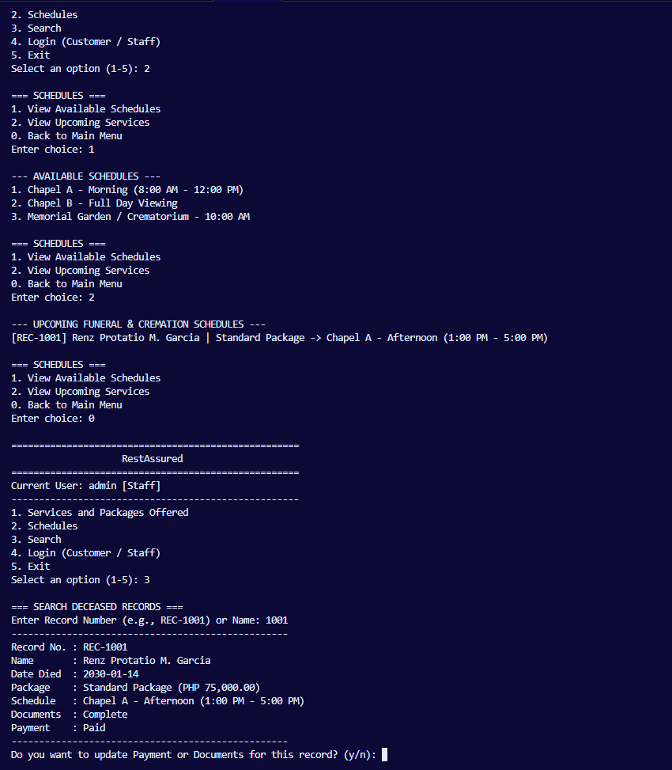

# RestAssured: Funeral Service and Memorial Management

***Description:*** "RestAssured" is a Java console-based management system designed to streamline funeral arrangements and record keeping. Families can conveniently browse available service packages, prices, and open schedules without needing to visit in person, while staff can log in to generate unique deceased record numbers, track required documents and payment statuses, and quickly search or update client records.

---

### Problem being Addressed

The Funeral Service and Memorial Management System aims to help funeral homes organize and manage deceased records, funeral service packages, schedules, and required documents. It will also allow families to arrange funeral services and access memorial information. This system can help reduce manual paperwork, organize records, and make funeral arrangements easier to manage for both users and managers. 

---

### Project Objectives
The program aims to: 
1.	 Organize and maintain deceased and family records.
2.	 Manage funeral service packages and their prices.
3.	 Record and monitor wake and burial schedules.
4.	 Track required documents and payment records.
5.	 Provide a search function to retrieve deceased records using a unique reference number.
---

### Target users
1.Funeral Home Administrator - Manages deceased records, funeral packages, schedules, documents, and payments.
2.Family Representative - Provides the deceased's information, selects funeral services, and views service schedules and memorial information.

---

### Main features
---
```
A. Funeral Package Management - Manages available funeral packages, services, and prices.
B. Schedule Management - Records wake and burial schedules.
C. Document and Payment Tracking - Monitors submitted documents, total costs, payments, and remaining balances.
D. Record Search and Memorial Information - Searches records using a unique reference number and displays authorized memorial information.
E. Access Control - Allow login to limit the access of every information in public allowing two options for the user if they are a customer or staff.
```
---

### Technologies used
---
```
1. Java – The main programming language used to develop the system.
2. Java Collections Framework – Uses ArrayList, List, and HashMap to store and manage funeral packages, deceased records, schedules, and user accounts.
3. Java Scanner Class – Used to accept user input through the console.
4. Java String Formatting – Uses System.out.printf() and String.format() to display organized information, including package prices and records.
5. Java IDE / Compiler – Used to write, compile, and run the Java program.
```
---

### Team members and roles
---
```
De Guzman, Leahne Allen E. - Documentation
Hernandez, Via Elaine B. - System/Design Lead
Imperio, Renz Harry A.- Lead Programmer
Quinio, Myiesha Janel D. - Project Leader
```
---

### OOP Concepts demonstrated
---

```
Encapsulation

private String recordId;
private String fullName;
private String dateOfDeath;
private String schedule;
private String paymentStatus;
private boolean documentsComplete;

This shows encapsulation because the variables are declared as private. This means other classes cannot directly change the information.

Abstraction

public abstract class FuneralService {
    protected String packageName;
    protected double basePrice;

    public abstract String displayDetails();
}

This shows abstraction because the class provides the basic information needed for funeral packages. It also has an abstract method called displayDetails() that must be completed by the other package classes.

Inheritance

class BurialPackage extends FuneralService {
}

class PremiumMemorialPackage extends FuneralService {
}

This shows inheritance because both classes use extends to get the properties and methods from the FuneralService class. This allows them to share common information without writing the same code again.

Polymorphism

@Override
public String displayDetails() {
    return String.format("%s - PHP %,.2f\n   Inclusions: %s Casket, %d-Day Viewing, %s",
            packageName, basePrice, casketType, viewingDays, extras);
}

This shows polymorphism because both funeral package classes use the same displayDetails() method but show different information. The Burial Package displays its regular inclusions, while the Premium Memorial Package displays its premium services.
```
---

### Instructions for running the program 
---
### SYSTEM REQUIREMENTS & SETUP

1. Ensure that Java Development Kit (JDK 17 or higher) is installed and configured on your system.
2. Click the **Code** button on this repository and select **Download ZIP** (or clone the repository directly).
3. Extract the downloaded archive to an accessible folder on your computer.

### EXECUTION STEPS

1. Launch Visual Studio Code or your preferred Java IDE.
2. Open the extracted project folder and navigate into the `src` directory.
3. Select `Main.java` and click **Run**, or open a terminal inside `src` and execute `javac *.java` followed by `java Main`.
4. *(Optional)* To access staff-level record management features, select **Login** from the main menu and sign in using `admin` as the username and `admin123` as the password.

---

### Sample screenshots
---




---

### Known limitations
---
```
A. Manual Data Entry – Staff will enter and update information; the system will not automatically collect information from external agencies.
B. Basic Reporting Only – The system will provide basic record and payment summaries, but not advanced analytic or predictions.
C. No Online Payment Integration – The initial version will record payments but will not process GCash, credit-card, or other online transactions.
D. No Online Copy of Documents - only basic information about the person is known and it will not extend to any online uploading and storing of legit documents and personal papers. Documents are all given personally.
```
---

### Future improvements
---
```
A. Graphical User Interface (GUI) – Upgrade from a console-based screen to a visual desktop or web application to make it easier for families and staff to use.
B. Online Document Upload – Allow families and staff to upload and store digital copies of required documents instead of submitting everything in person.
C. Online Payment Integration – Support online payment methods such as GCash, bank transfers, and credit/debit cards alongside cash payments.
D. Printable Receipts and Reports – Generate downloadable or printable summaries, official receipts, and monthly financial reports.
E. Stronger Security and Accounts – Add password encryption, separate staff and admin roles, and activity logs to track record changes.
```
---

### Project contributors
1. De Guzman, Leahne Allen E.
2. Hernandez, Via Elaine B. 
3. Imperio, Renz Harry A.
4. Quinio, Myiesha Janel D.

---
