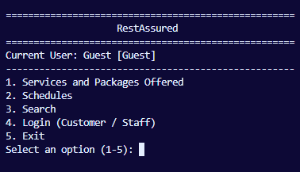
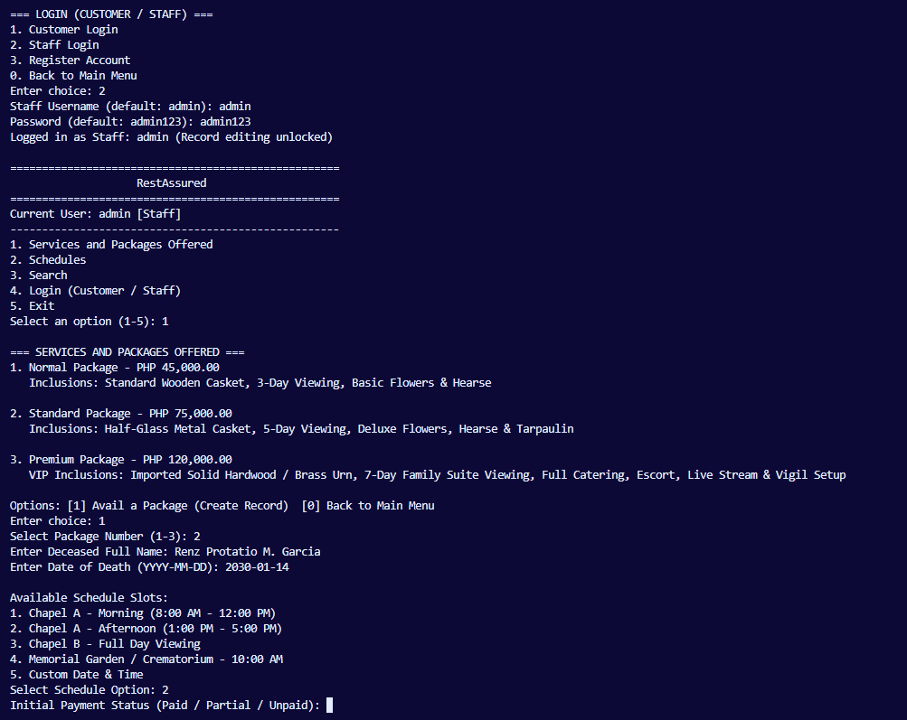
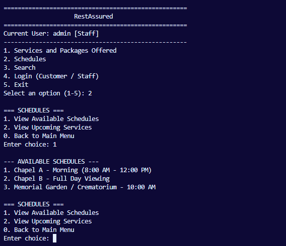

# Funeral Service and Memorial Management

***Description:*** "RestAssured" is a Java console-based management system designed to streamline funeral arrangements and record keeping. Families can conveniently browse available service packages, prices, and open schedules without needing to visit in person, while staff can log in to generate unique deceased record numbers, track required documents and payment statuses, and quickly search or update client records.

---

1. Project title

---

2. Project description

---

3. Problem being addressed

---

4. Project objectives

---

5. Target users

---

6. Main features

---

7. Technologies used
```
1. Java – The main programming language used to develop the system.
2. Java Collections Framework – Uses ArrayList, List, and HashMap to store and manage funeral packages, deceased records, schedules, and user accounts.
3. Java Scanner Class – Used to accept user input through the console.
4. Java String Formatting – Uses System.out.printf() and String.format() to display organized information, including package prices and records.
5. Java IDE / Compiler – Used to write, compile, and run the Java program.
```
---

8. Team members and roles

---

9. OOP Concepts demonstrated


```
Encapsulation

private String recordId;
private String fullName;
private String dateOfDeath;
private String schedule;
private String paymentStatus;
private boolean documentsComplete;

This shows encapsulation because the variables are declared as private. This means other classes cannot directly change the information.

Abstraction

public abstract class FuneralService {
    protected String packageName;
    protected double basePrice;

    public abstract String displayDetails();
}

This shows abstraction because the class provides the basic information needed for funeral packages. It also has an abstract method called displayDetails() that must be completed by the other package classes.

Inheritance

class BurialPackage extends FuneralService {
}

class PremiumMemorialPackage extends FuneralService {
}

This shows inheritance because both classes use extends to get the properties and methods from the FuneralService class. This allows them to share common information without writing the same code again.

Polymorphism

@Override
public String displayDetails() {
    return String.format("%s - PHP %,.2f\n   Inclusions: %s Casket, %d-Day Viewing, %s",
            packageName, basePrice, casketType, viewingDays, extras);
}

This shows polymorphism because both funeral package classes use the same displayDetails() method but show different information. The Burial Package displays its regular inclusions, while the Premium Memorial Package displays its premium services.
```
---

10. Instructions for running the program 

## Instructions for Running the Program

### SYSTEM REQUIREMENTS & SETUP

1. Ensure that Java Development Kit (JDK 17 or higher) is installed and configured on your system.
2. Click the **Code** button on this repository and select **Download ZIP** (or clone the repository directly).
3. Extract the downloaded archive to an accessible folder on your computer.

### EXECUTION STEPS

1. Launch Visual Studio Code or your preferred Java IDE.
2. Open the extracted project folder and navigate into the `src` directory.
3. Select `Main.java` and click **Run**, or open a terminal inside `src` and execute `javac *.java` followed by `java Main`.
4. *(Optional)* To access staff-level record management features, select **Login** from the main menu and sign in using `admin` as the username and `admin123` as the password.
---

11. Sample screenshots
---




12. Known limitations

---

13. Future improvements

---

14. Project contributors

---
